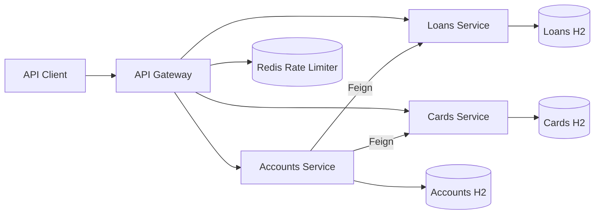

# CrediNest — Digital Banking System

CrediNest is a Java and Spring Boot backend project that demonstrates banking-domain microservices for managing customers, accounts, loans, and cards. It combines REST APIs, service discovery, centralized configuration, customer-data aggregation, resilience patterns, and containerized local deployment.

The repository currently contains backend services. User login, a frontend dashboard, fund transfers, and transaction history are outside the current implementation.

## Features

- Create, retrieve, update, and delete customer/account records.
- Manage loan and card records through dedicated REST APIs.
- Retrieve an aggregated customer view containing account, loan, and card information.
- Communicate between services using Spring Cloud OpenFeign and Eureka discovery.
- Load application configuration through Spring Cloud Config Server.
- Route client requests through Spring Cloud Gateway.
- Demonstrate circuit breakers, retries, timeouts, and Redis-backed request rate limiting.
- Propagate correlation IDs through gateway filters and downstream requests.
- Describe business APIs using Springdoc OpenAPI annotations and Swagger UI dependencies.
- Build container images with Jib and run services using Docker Compose.

## Technology Stack

| Area | Technology |
|---|---|
| Language | Java 21 |
| Application framework | Spring Boot 3.4.1 |
| Microservice infrastructure | Spring Cloud 2024.0.0 |
| Persistence | Spring Data JPA and H2 in-memory databases |
| Service communication | REST and Spring Cloud OpenFeign |
| Service discovery | Netflix Eureka |
| Central configuration | Spring Cloud Config Server |
| API gateway | Spring Cloud Gateway |
| Resilience | Resilience4j and gateway filters |
| Rate-limit storage | Redis |
| API documentation | Springdoc OpenAPI / Swagger UI |
| Build and containers | Maven Wrapper, Jib, Docker, Docker Compose |

The checked-in service configurations and dependencies use **H2**, not MySQL. Each business service has its own in-memory database; its records are lost when that service restarts.

## Services

| Service | Port | Responsibility |
|---|---|---|
| `configserver` | `8071` | Provides configuration from a Git-backed configuration repository |
| `eurekaserver` | `8070` | Maintains the service registry |
| `gatewayserver` | `8072` | Routes requests and applies gateway filters |
| `accounts` | `8080` | Manages customers/accounts and aggregates customer details |
| `loans` | `8090` | Manages loan records |
| `cards` | `9000` | Manages card records |
| Redis | `6379` | Supports the gateway's Cards-route rate limiter |

Ports reflect the supplied Compose files and configuration repository. Changing the external configuration can change runtime behavior.

## Architecture



Config Server supplies application settings, while Eureka supports service discovery and the gateway's load-balanced routes. Business services use controller, service, repository, and DTO layers.

### Customer details request flow

1. A client calls `GET /eazybank/accounts/api/fetchCustomerDetails?mobileNumber=...` through the gateway.
2. The gateway forwards the request to Accounts Service and adds a correlation ID when one is missing.
3. Accounts Service reads the customer and account records from its database.
4. Feign clients request loan and card details from the corresponding services.
5. Accounts Service combines the available results into a customer-details response.

The Feign fallback implementations return no downstream result, so loan or card details can be omitted when a fallback is used. This response is not a shared transaction across the three services.

## Repository Structure

```text
.
├── accounts/
├── cards/
├── loans/
├── configserver/
├── eurekaserver/
├── gatewayserver/
├── docker-compose/
│   ├── default/
│   ├── qa/
│   └── prod/
└── README.md
```
